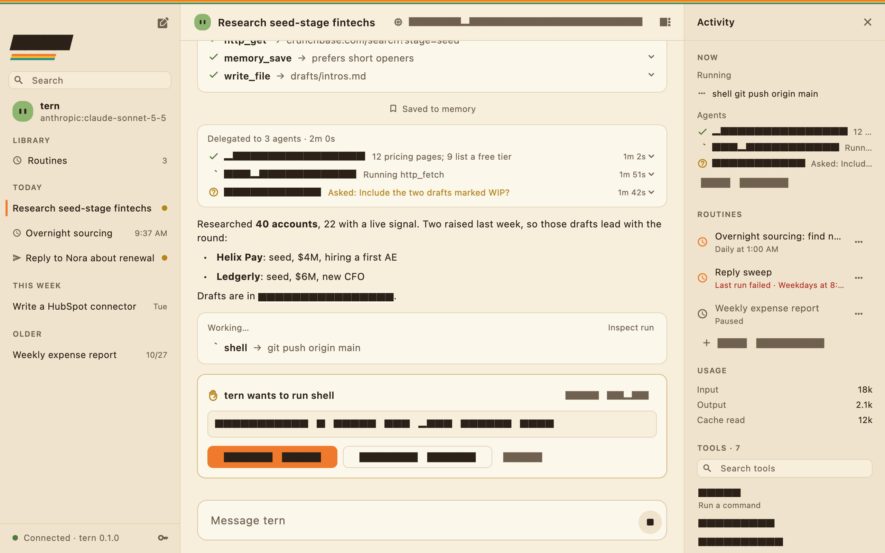
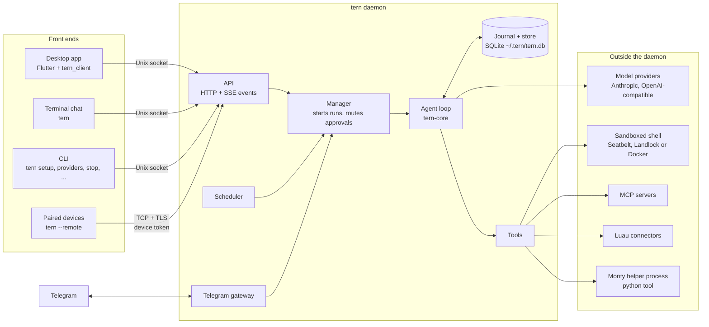
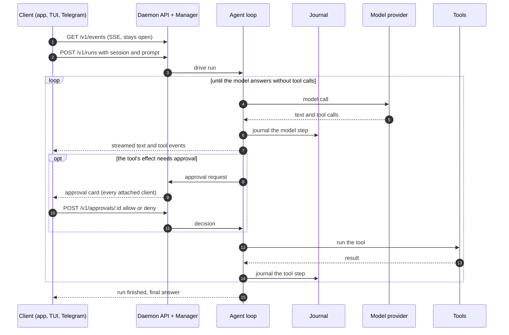
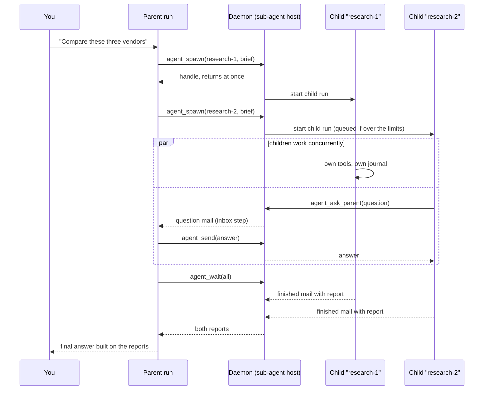
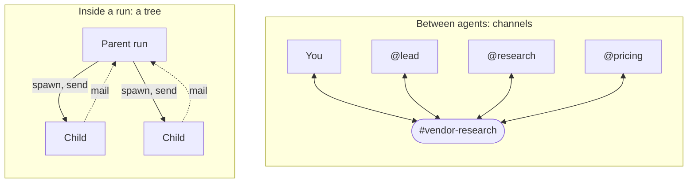
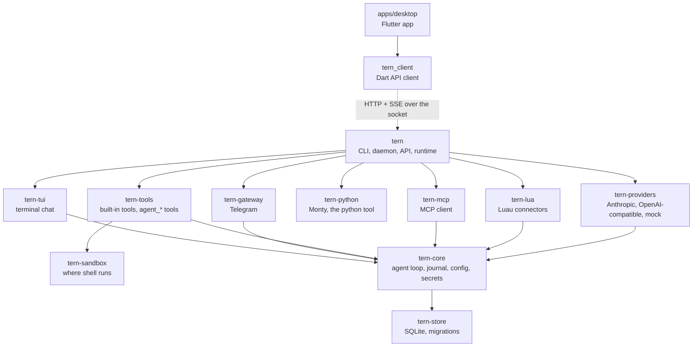

# tern

A personal AI agent you run yourself, shipped as **one static binary**: no Python, no Node, no Docker required. It chats in your terminal, on Telegram, and in a macOS desktop app. You can keep several **agents**, each with its own persona, model, tools and memory, starting from a catalog of 23 starters (research, inbox, code review, bug fixing, writing, SEO audits and more). They run scheduled routines, delegate to each other and to sub-agents, write their own sandboxed connectors for APIs nobody built one for, and ask before they run commands or change anything. It survives crashes: every model call and tool result is journaled, so a killed run resumes where it stopped without repeating completed work.

<!-- TODO(launch): replace this screenshot with docs/assets/demo.gif, the 90-second demo in docs/launch-plan.md §4.1
     (routine, Telegram approval, kill -9 and resume, agent-written connector). The screenshot is the desktop app
     rendered from demo data by apps/desktop/test/screenshot_test.dart. -->
<picture>
  <source media="(prefers-color-scheme: dark)" srcset="docs/assets/desktop-dark.png">
  
</picture>

macOS and Linux (the desktop app is macOS for now). Anthropic or any OpenAI-compatible model, including OpenRouter, Gemini, Groq, Together, and local servers such as Ollama and LM Studio. No telemetry.

**Docs:** [Reference](docs/reference.md) (every command and setting) · [FAQ](docs/faq.md) · [Security](SECURITY.md) · [Roadmap](ROADMAP.md) · [Design decisions](DECISIONS.md)

## Quick start

**Status: alpha.** The first release is [v0.1.0-alpha.1](https://github.com/mitchellalderson/tern-agent/releases/tag/v0.1.0-alpha.1), a GitHub *pre-release* (expect rough edges; how releases are cut: [docs/release-checklist.md](docs/release-checklist.md)). If the installer or the DMG link below says the release isn't there, it isn't published yet: build from a clone of this repository with Rust 1.89+:

```sh
git clone https://github.com/mitchellalderson/tern-agent && cd tern-agent
cargo build --profile dist -p tern                    # → target/dist/tern
install -m 755 target/dist/tern ~/.local/bin/tern     # or any directory on your PATH
tern setup     # choose a provider (Anthropic, OpenAI, OpenRouter, Gemini, Groq, Together, Ollama, LM Studio, or another), paste a key, pick a model
tern           # chat in the terminal
```

**From a release** (it replaces the `git clone`, `cargo build` and `install` lines). GitHub's "latest release" skips pre-releases, so the installer looks up the newest release itself, pre-releases included:

```sh
curl -fsSL https://raw.githubusercontent.com/mitchellalderson/tern-agent/main/install.sh | sh
```

The installer picks the right build for your machine, verifies its checksum, and installs to `~/.local/bin`; without a published release it says so and points here. To pin a version: `curl -fsSL https://raw.githubusercontent.com/mitchellalderson/tern-agent/main/install.sh | sh -s -- --version v0.1.0-alpha.1` (or `TERN_VERSION=v0.1.0-alpha.1`); `--stable` picks the newest release that is not a pre-release. To update, run it again (or rebuild), then `tern stop && tern start`: the background daemon keeps running the old version until restarted, and `tern start` and `tern doctor` warn when it differs from the `tern` you run. `tern setup` checks the key with the provider before saving it to `~/.tern/secrets.toml` (mode 0600). For scripts, `tern providers add openrouter` (or `anthropic`, `openai`, `gemini`, `groq`, `together`, `ollama`, `lmstudio`, or `openai-compat --url ...`) does the same without the questions; it reads the key from stdin or asks for it hidden.

Then make an agent from a starter, and use the rest as you need it:

```sh
tern agents templates                              # the 23 starters, by category, with each one's autonomy ceiling
tern agents new reviewer --template code-reviewer  # an agent with its own persona, tools, memory and DM
tern run "summarize ~/notes/today.md"   # one prompt, answer on stdout (--yes auto-approves tools)
tern start                              # run tern in the background: schedules, Telegram, the desktop app
tern service install                    # ...and start it at login
tern doctor                             # check everything and say what's missing
```

**Desktop app** (macOS 12+): download [`tern-desktop-macos.dmg`](https://github.com/mitchellalderson/tern-agent/releases/download/v0.1.0-alpha.3/tern-desktop-macos.dmg) from the v0.1.0-alpha.3 release (other versions: the [releases page](https://github.com/mitchellalderson/tern-agent/releases); the file name never carries a version, only the tag in the URL does, and `releases/latest` does not work for pre-releases) and drag tern to Applications. To build it instead on a Mac with Flutter installed: after the `cargo build` above, `scripts/release-macos.sh --dry-run target/dist/tern out/` writes an ad-hoc signed DMG (see [docs/desktop-release.md](docs/desktop-release.md)). The app is ad-hoc signed and not notarized yet (the `tern` CLI tarballs are unsigned; each has a `.sha256` and a build attestation), so macOS blocks the first open ("Apple cannot check it for malicious software"). To open it once: double-click it and dismiss the warning, open **System Settings › Privacy & Security**, scroll to the message about tern, click **Open Anyway** and confirm with your password (on macOS 12 to 14, right-click the app and choose **Open** instead). To remove tern later see [Back up, update and uninstall](docs/reference.md#back-up-update-and-uninstall): trashing the app does not stop its background process. The app carries its own `tern`, so you don't need the CLI. On first launch it asks where tern should run (this Mac, with an option to start at login and a menu-bar icon, or a tern server you pair with). Then open **Settings** (⌘,), go to **Models & Providers** and pick a provider from the presets (Anthropic, OpenAI, OpenRouter, Gemini, Groq, Together, Ollama, LM Studio, or another OpenAI-compatible address), paste a key, and choose a model. Under AGENTS in the sidebar, **+** opens the agent sheet: pick a starter from the searchable list, adjust it if you like, and Create. If a run fails because of a key, address or quota, the conversation says so in plain words, with the raw error under "Show details".

**Telegram**, remote devices, schedules, MCP servers, connectors, sandboxing and every other option are covered in the [reference](docs/reference.md).

## What it does

- **Agents of your own.** Each agent has a name (`@name`), persona, model list, tool scope, private or shared memory, routines and a DM. Start from one of 23 starters across Everyday, Coding, Writing & Content, Research & Learning and Business, or from Blank. Every starter carries a conservative **autonomy ceiling** (read-only for look-only roles, otherwise supervised), and you can set a ceiling on any agent: a cap on what it may do on its own, never a grant. Agents can be renamed, edited, archived or deleted, in the desktop app, the TUI and `tern agents`. Even a read-only agent keeps its own notes (it still can't touch files or run commands): they are capped, logged in the ledger, marked `unverified` if it had read untrusted content, recalled as data, and you can view, edit and clear them. A routine's next run is given its last report, so "what changed since last time" works.
- **Agents working together.** An agent can hand work to another (`@name`), agents share topic channels and wake on `@mention`, and a channel can switch on **Let agents decide**, where tern routes a post to the agent that fits. Each agent can have a Telegram bot of its own. Agents, with routines and skills, can be packaged as signed **bundles**; installing one shows everything it can do first.
- **Code auto mode (opt-in, not fully sandboxed).** For a coding agent you trust with a folder: turn it on per agent (the autonomy list in the agent sheet, `/autonomy code`, or `tern agents code-auto`) and it edits files and runs build and test commands in its workspace without asking, while the OS sandbox is verified active. It still asks for the network, installs, `git push`, big deletions and anything after reading untrusted content; a snapshot is saved before each run changes anything (`tern runs undo`); every unasked call is in the ledger. Read what it does not protect before you switch it on ([reference](docs/reference.md#code-auto-mode), [SECURITY](SECURITY.md)).
- **Approvals that don't nag.** Risky steps wait for you as cards in the conversation, on Telegram or in the terminal. In the desktop app and terminal you can approve **once, for this run, for this conversation, or always** for that exact thing (a different tool, draft, host or account asks again); repeated identical approvals collapse into one line. Writes from unattended runs wait in an **outbox** instead of blocking.
- **Routines and skills.** Schedules, cron and one-off triggers, webhooks, and watches that remember where they left off. After a long, clean run tern offers to save it as a **skill**: it writes a draft, and nothing is published until you review it.
- **Compute without `shell`.** The `python` tool runs scripts in a sandboxed Python subset (Monty) that call tern's tools as functions. Every call is checked and journaled, a call that needs approval pauses the script and asks you, `gather` runs calls in parallel, and writes from scripts are off unless you turn them on.
- **Connectors and MCP.** The agent writes Luau connectors that run sandboxed with credentials injected by the host, can build one from an OpenAPI document, and signs in with OAuth where a service offers it. MCP servers are managed from chat, the CLI, the TUI and the desktop app (platform-wide settings are all in one place too: Settings in the app, `/settings` in the terminal), and `tern mcp serve` offers tern's tools to other agents.
- **Keeping watch.** A hash-chained activity ledger, a Tasks view of everything running or waiting on you (`tern tasks`), and `tern security audit`.
- **Stays out of the way.** `tern start` and `tern service install` run it in the background, with a menu-bar icon on macOS and a tray icon on Linux. Schedules run while tern is running: a sleeping laptop pauses them, and a missed one runs once on wake. For round-the-clock routines, run it on an always-on machine or server.

What it doesn't do (no built-in browser, no Windows build, no hosted version, no desktop app on Linux yet) is spelled out in the [FAQ](docs/faq.md) and the [roadmap](ROADMAP.md).

## Architecture

### Front ends and the daemon

Everything that matters lives in one process, the **daemon** (`tern daemon`, or `tern start` to run it in the background). It owns the database, drives every run, runs schedules, and hosts the Telegram gateway. Front ends hold no state of their own. They attach over the daemon's API (a Unix socket, plus TCP for paired remote devices), so you can start a conversation in the desktop app, approve a step from your phone, and watch it finish in the terminal.



`tern run` always runs its prompt in-process, and `tern` does too when no daemon is running, so the CLI works on its own. Both use the same `~/.tern` data the daemon does.

### A run, step by step

A **session** is a conversation; a **run** is one prompt driven to a final answer within it. Clients start runs with a request and follow them on one long-lived event stream. Every model call and tool result is written to the journal before the loop moves on, which is what makes a run resumable.



If the daemon dies mid-run, the next start finds the run still `running` and resumes it: journaled steps are replayed instead of re-executed, so a completed tool call never runs twice.

### Sub-agents

A run can delegate, and your agents are proactive about it: each one that may hand work on sees a short roster of its peers (what each is for and its autonomy ceiling) and hands a request that is clearly in a specialist's lane (an SEO audit to `seo`, a review to `code-reviewer`) to that agent, saying so as it does, instead of doing it badly itself; the delegate keeps its own tools and ceiling. `agent_spawn` starts a **child run** in a session of its own with a fresh context: its brief is its first message. The child is an ordinary run (journaled, resumable, cancellable) driven concurrently with its parent. Parent and child talk through **mail** that the daemon stores: the parent picks it up at its next model call (an `inbox` step in its journal) or by blocking in `agent_wait`.



- **Approvals** from a child go to the conversation you're looking at, labelled with the child's name ("research-1 wants to run …").
- **Limits** (`[subagents]` in config): depth, concurrency per parent and across tern, children per run, and per-child iterations and token budget. Over the limit, children wait as `queued`.
- **A parent can't finish while its children are still running**: the loop waits for their reports first. Cancelling a run cancels its whole subtree.
- **Tool scope and model** are per child: `all`, `read_only`, or a list of tools, and a model alias such as `fast` or a `provider:model`.

The full design is in [docs/subagents-design.md](docs/subagents-design.md).

### Agents and channels

Delegation inside a run is a **tree**: one parent, its children, and mail that flows only along the edges. On top of that, tern has **channels**: shared chat streams that you and your agents both post to and read, so agents can hand off and report in the open rather than through private mailboxes. Home is one stream, each agent has a DM, and topic channels (in the desktop app, the TUI, and on Telegram as topics or `#slug` prefixes) hold work on one subject. Agents in a channel read each other's posts and wake on `@mention`; with **Let agents decide** on, tern routes a post to the agent whose job fits. Agents can suggest a channel for a piece of work, and you accept or decline. Conversations are flat: no reply threads or side chats.



What makes runs dependable carries over: every agent turn is a journaled run, messages are stored before anyone acts on them, and approvals still come to you. Each agent's power is bounded by its tool scope and autonomy ceiling, and a sub-agent takes the lower of its caller's and its own. The designs are in [docs/channels-design.md](docs/channels-design.md) and [docs/agent-profiles-design.md](docs/agent-profiles-design.md).

## Development

The repo has two halves that meet only over the daemon's API: the Rust engine (`crates/`, built into the single `tern` binary) and the Flutter desktop app (`apps/desktop`, see [its README](apps/desktop/README.md)).



### Build and test

```sh
cargo build -p tern       # → target/debug/tern
cargo test-all            # everything CI runs for tests: Rust, then Dart
cargo test-all --rust     # only the Rust suites
cargo test-all --dart     # only the Dart suites
```

Agents work in a folder you choose per channel, topic or agent (`tern workspace`); file tools can't reach outside it, and shell commands are bounded by the OS sandbox or, where there is none, ask every time and never run unattended.

`cargo test-all` builds `target/debug/tern`, then runs the workspace tests, a TUI smoke test in a pseudo-terminal, and the `tern_client` and desktop app tests. Their live tests run against the fresh build. Every step runs even if an earlier one fails, with a summary at the end. It needs `python3`, and Flutter 3.47+ for the Dart suites. CI runs the same suites in parallel jobs (`cargo test-all --rust` and `--dart`), plus `cargo fmt --check`, clippy, `flutter analyze`, and the tests against the shipped `dist` binary. Suites that need something extra run by hand:

```sh
cargo test -p tern-sandbox -- --ignored real_docker      # needs Docker
TERN_SMOKE_MODEL=anthropic:claude-sonnet-5-5 ANTHROPIC_API_KEY=... cargo test -p tern --test it -- --ignored m1::real_provider
```

Tests use a scripted mock provider (`TERN_PROVIDER=mock:<script.json>`), so they need no network or API key. `cargo build --release` is the fast optimized build; `--profile dist` is the smaller, slower one used for shipped binaries.

### After changing Rust code, restart the daemon

The app and an attached `tern` chat talk to whichever daemon is already running, and that daemon keeps running the binary it started from. Hot reload in `flutter run` only reloads Dart. So after changing anything under `crates/`:

```sh
tern stop                   # stop the old daemon
cargo build -p tern
target/debug/tern daemon    # start the new one
```

The app reconnects and resyncs on its own. Runs in progress resume in the new daemon, so restarting mid-run is safe (and a quick way to test crash recovery). To check which daemon you're talking to, compare the `pid` from `curl -s --unix-socket ~/.tern/tern.sock http://tern/v1/health` with the one you started; `version` doesn't change between dev builds.

### Point the app at your build

When no daemon is running, the app's **Start tern** looks for a binary in this order: `$TERN_BIN`, the one inside the app bundle (release builds only), your `PATH`, then `~/.cargo/bin`, `~/.local/bin`, `/opt/homebrew/bin` and `/usr/local/bin`. An installed release `tern` wins over your build unless you say otherwise:

```sh
cd apps/desktop
TERN_BIN=$PWD/../../target/debug/tern flutter run -d macos
```

### Keep your real data out of it

Every command, the daemon and the app honour `TERN_HOME`. The demo script runs a daemon with the mock provider in a throwaway home, with no API key needed:

```sh
apps/desktop/tool/demo_daemon.sh                  # prints TERN_HOME
TERN_HOME=<printed path> flutter run -d macos     # in apps/desktop
TERN_HOME=<printed path> target/debug/tern        # the TUI against the same daemon
```

It builds `target/debug/tern` only if it's missing, so run `cargo build -p tern` first after a Rust change. Any message runs a scripted reply, and one containing "approve" asks for an approval.

### Changing the API

Routes live in `crates/tern/src/daemon/api*.rs`; the app's client is `apps/desktop/packages/tern_client`. When a route or payload changes, update `tern_client/lib/src/models.dart` and `client.dart` to match, and run `cargo test-all --dart` to check them against a real daemon.

### Tips

- `TERN_LOG=debug` makes `~/.tern/logs/` verbose.
- `tern runs show <id>` prints a run's step journal: what it did and where an unfinished one stopped.
- `TERN_SCHEDULER_TICK_MS=1000 target/debug/tern daemon` checks schedules every second instead of every 30.
- With a long `TERN_HOME`, `tern.sock` is a symlink to a shorter path (sockets are limited to about 100 characters). curl doesn't follow it, so pass it `"$(readlink <TERN_HOME>/tern.sock)"`.
- Design decisions and why they were made are in [DECISIONS.md](DECISIONS.md); specs are in [docs/](docs/).
