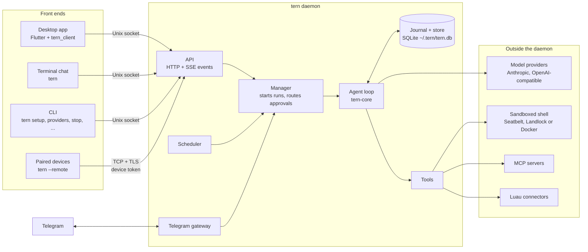
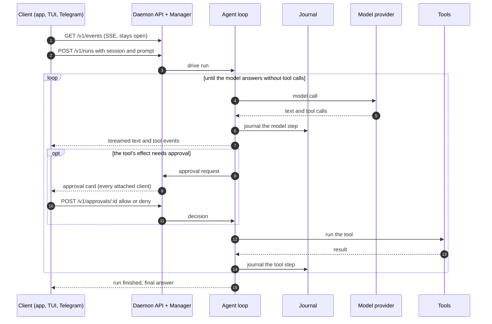
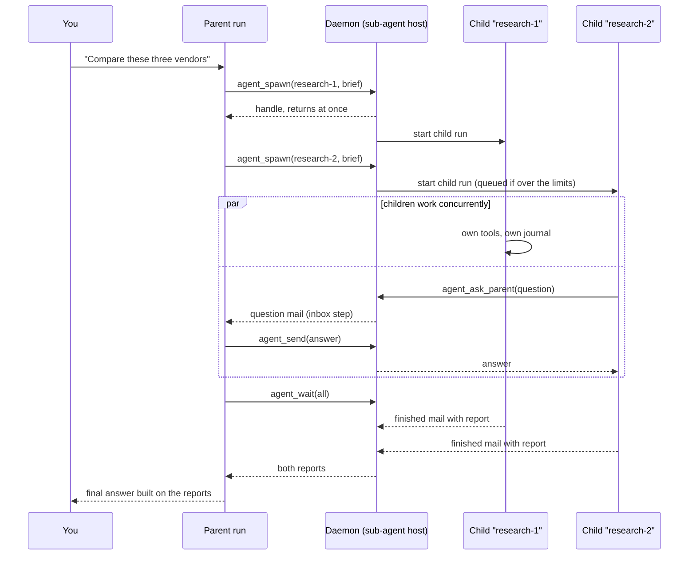
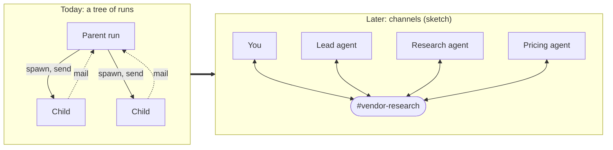
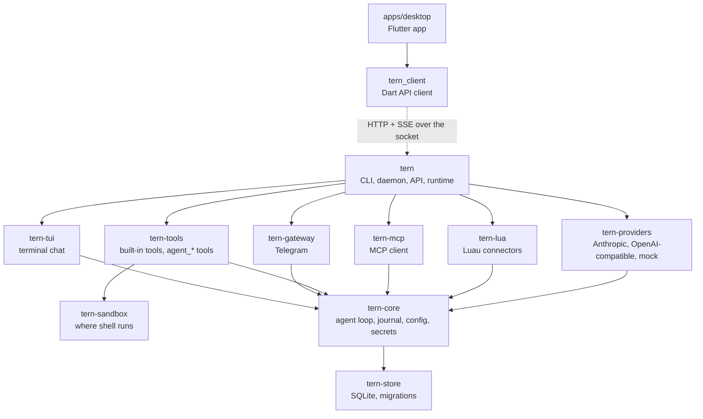

# tern

A personal AI agent you run yourself, shipped as **one static binary**: no Python, no Node, no Docker required. It chats in your terminal, on Telegram, and in a macOS desktop app. It also runs scheduled routines, delegates to sub-agents, writes its own sandboxed connectors for APIs nobody built one for, and asks before it runs commands. It survives crashes: every model call and tool result is journaled, so a killed run resumes where it stopped without repeating completed work.

<!-- TODO(launch): replace this screenshot with docs/assets/demo.gif, the 90-second demo in docs/launch-plan.md §4.1
     (routine, Telegram approval, kill -9 and resume, agent-written connector). The screenshot is the desktop app
     rendered from demo data by apps/desktop/test/screenshot_test.dart. -->
<picture>
  <source media="(prefers-color-scheme: dark)" srcset="docs/assets/desktop-dark.png">
  
</picture>

macOS and Linux. Anthropic or any OpenAI-compatible model, including local ones. No telemetry.

**Docs:** [Reference](docs/reference.md) (every command and setting) · [FAQ](docs/faq.md) · [Security](SECURITY.md) · [Roadmap](ROADMAP.md) · [Design decisions](DECISIONS.md)

## Quick start

```sh
curl -fsSL https://raw.githubusercontent.com/mitchellalderson/tern-agent/main/install.sh | sh
tern setup     # choose Anthropic or an OpenAI-compatible server, paste a key, pick a model
tern           # chat in the terminal
```

The installer picks the right build for your machine, verifies its checksum, and installs to `~/.local/bin`. `tern setup` checks the key with the provider before saving it to `~/.tern/secrets.toml` (mode 0600).

Then, as you need them:

```sh
tern run "summarize ~/notes/today.md"   # one prompt, answer on stdout (--yes auto-approves tools)
tern start                              # run tern in the background: schedules, Telegram, the desktop app
tern service install                    # ...and start it at login
tern doctor                             # check everything and say what's missing
```

**Desktop app** (macOS 11+): download [tern-desktop-macos.dmg](https://github.com/mitchellalderson/tern-agent/releases/latest/download/tern-desktop-macos.dmg) and drag tern to Applications. It carries its own `tern`, so you don't need the CLI. On first launch it asks where tern should run (this Mac, with an option to start at login and a menu-bar icon, or a tern server you pair with); then add a model.

**Telegram**, remote devices, schedules, MCP servers, connectors, sandboxing and every other option are covered in the [reference](docs/reference.md).

## Architecture

### Front ends and the daemon

Everything that matters lives in one process, the **daemon** (`tern daemon`, or `tern start` to run it in the background). It owns the database, drives every run, runs schedules, and hosts the Telegram gateway. Front ends hold no state of their own. They attach over the daemon's API (a Unix socket, plus TCP for paired remote devices), so you can start a conversation in the desktop app, approve a step from your phone, and watch it finish in the terminal.



`tern run` always runs its prompt in-process, and `tern` does too when no daemon is running, so the CLI works on its own. Both use the same `~/.tern` data the daemon does.

### A run, step by step

A **session** is a conversation; a **run** is one prompt driven to a final answer within it. Clients start runs with a request and follow them on one long-lived event stream. Every model call and tool result is written to the journal before the loop moves on, which is what makes a run resumable.



If the daemon dies mid-run, the next start finds the run still `running` and resumes it: journaled steps are replayed instead of re-executed, so a completed tool call never runs twice.

### Sub-agents

A run can delegate. `agent_spawn` starts a **child run** in a session of its own with a fresh context: its brief is its first message. The child is an ordinary run (journaled, resumable, cancellable) driven concurrently with its parent. Parent and child talk through **mail** that the daemon stores: the parent picks it up at its next model call (an `inbox` step in its journal) or by blocking in `agent_wait`.



- **Approvals** from a child go to the conversation you're looking at, labelled with the child's name ("research-1 wants to run …").
- **Limits** (`[subagents]` in config): depth, concurrency per parent and across tern, children per run, and per-child iterations and token budget. Over the limit, children wait as `queued`.
- **A parent can't finish while its children are still running**: the loop waits for their reports first. Cancelling a run cancels its whole subtree.
- **Tool scope and model** are per child: `all`, `read_only`, or a list of tools, and a model alias such as `fast` or a `provider:model`.

The full design is in [docs/subagents-design.md](docs/subagents-design.md).

### Where this is heading: channels

Today delegation is a **tree**: one parent, its children, and mail that flows only along the edges. The direction we're exploring is **channels**, shared chat streams that people and agents both post to and read from, where agents join, hand off, and report in the open rather than through private mailboxes. This is a sketch, not a design: nothing below is built, and the open questions are in [docs/gui-spec.md](docs/gui-spec.md) §11.



The pieces that should carry over are the ones that make runs dependable now: every agent turn is still a journaled run, messages are stored before anyone acts on them, and approvals still come to you.

## Development

The repo has two halves that meet only over the daemon's API: the Rust engine (`crates/`, built into the single `tern` binary) and the Flutter desktop app (`apps/desktop`, see [its README](apps/desktop/README.md)).



### Build and test

```sh
cargo build -p tern       # → target/debug/tern
cargo test-all            # everything CI runs for tests: Rust, then Dart
cargo test-all --rust     # only the Rust suites
cargo test-all --dart     # only the Dart suites
```

`cargo test-all` builds `target/debug/tern`, then runs the workspace tests, a TUI smoke test in a pseudo-terminal, and the `tern_client` and desktop app tests. Their live tests run against the fresh build. Every step runs even if an earlier one fails, with a summary at the end. It needs `python3`, and Flutter 3.47+ for the Dart suites. CI runs the same command, plus `cargo fmt --check`, clippy, and `flutter analyze`. Suites that need something extra run by hand:

```sh
cargo test -p tern-sandbox -- --ignored real_docker      # needs Docker
TERN_SMOKE_MODEL=anthropic:claude-sonnet-5-5 ANTHROPIC_API_KEY=... cargo test -p tern --test m1 -- --ignored real_provider
```

Tests use a scripted mock provider (`TERN_PROVIDER=mock:<script.json>`), so they need no network or API key. `cargo build --release` is the fast optimized build; `--profile dist` is the smaller, slower one used for shipped binaries.

### After changing Rust code, restart the daemon

The app and an attached `tern` chat talk to whichever daemon is already running, and that daemon keeps running the binary it started from. Hot reload in `flutter run` only reloads Dart. So after changing anything under `crates/`:

```sh
tern stop                   # stop the old daemon
cargo build -p tern
target/debug/tern daemon    # start the new one
```

The app reconnects and resyncs on its own. Runs in progress resume in the new daemon, so restarting mid-run is safe (and a quick way to test crash recovery). To check which daemon you're talking to, compare the `pid` from `curl -s --unix-socket ~/.tern/tern.sock http://tern/v1/health` with the one you started; `version` doesn't change between dev builds.

### Point the app at your build

When no daemon is running, the app's **Start tern** looks for a binary in this order: `$TERN_BIN`, the one inside the app bundle (release builds only), your `PATH`, then `~/.cargo/bin`, `~/.local/bin`, `/opt/homebrew/bin` and `/usr/local/bin`. An installed release `tern` wins over your build unless you say otherwise:

```sh
cd apps/desktop
TERN_BIN=$PWD/../../target/debug/tern flutter run -d macos
```

### Keep your real data out of it

Every command, the daemon and the app honour `TERN_HOME`. The demo script runs a daemon with the mock provider in a throwaway home, with no API key needed:

```sh
apps/desktop/tool/demo_daemon.sh                  # prints TERN_HOME
TERN_HOME=<printed path> flutter run -d macos     # in apps/desktop
TERN_HOME=<printed path> target/debug/tern        # the TUI against the same daemon
```

It builds `target/debug/tern` only if it's missing, so run `cargo build -p tern` first after a Rust change. Any message runs a scripted reply, and one containing "approve" asks for an approval.

### Changing the API

Routes live in `crates/tern/src/daemon/api*.rs`; the app's client is `apps/desktop/packages/tern_client`. When a route or payload changes, update `tern_client/lib/src/models.dart` and `client.dart` to match, and run `cargo test-all --dart` to check them against a real daemon.

### Tips

- `TERN_LOG=debug` makes `~/.tern/logs/` verbose.
- `tern runs show <id>` prints a run's step journal: what it did and where an unfinished one stopped.
- `TERN_SCHEDULER_TICK_MS=1000 target/debug/tern daemon` checks schedules every second instead of every 30.
- With a long `TERN_HOME`, `tern.sock` is a symlink to a shorter path (sockets are limited to about 100 characters). curl doesn't follow it, so pass it `"$(readlink <TERN_HOME>/tern.sock)"`.
- Design decisions and why they were made are in [DECISIONS.md](DECISIONS.md); specs are in [docs/](docs/).
